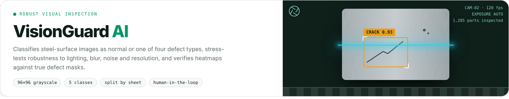
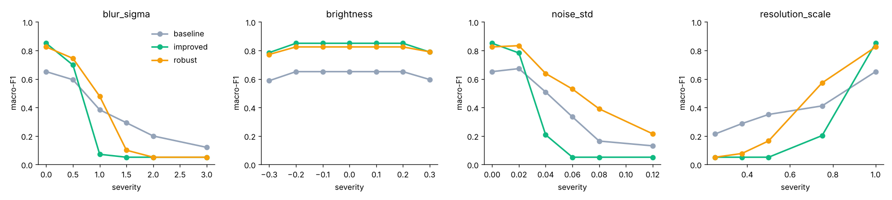
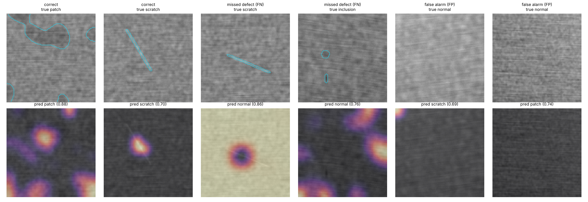
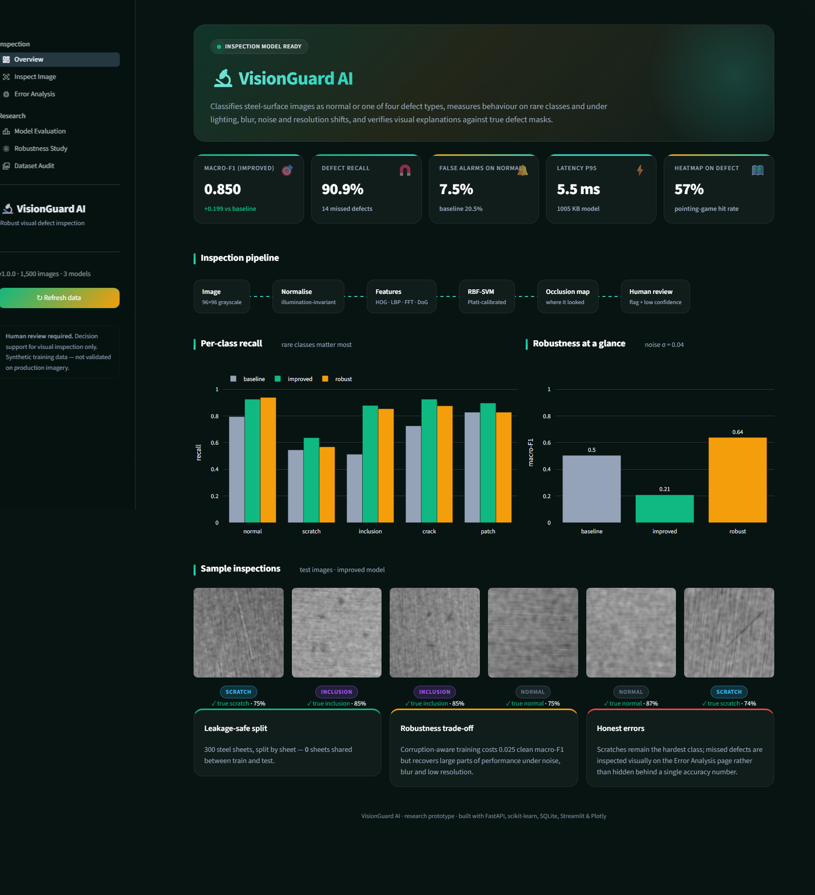
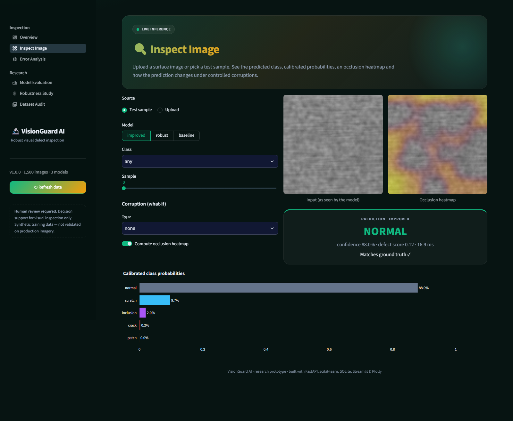
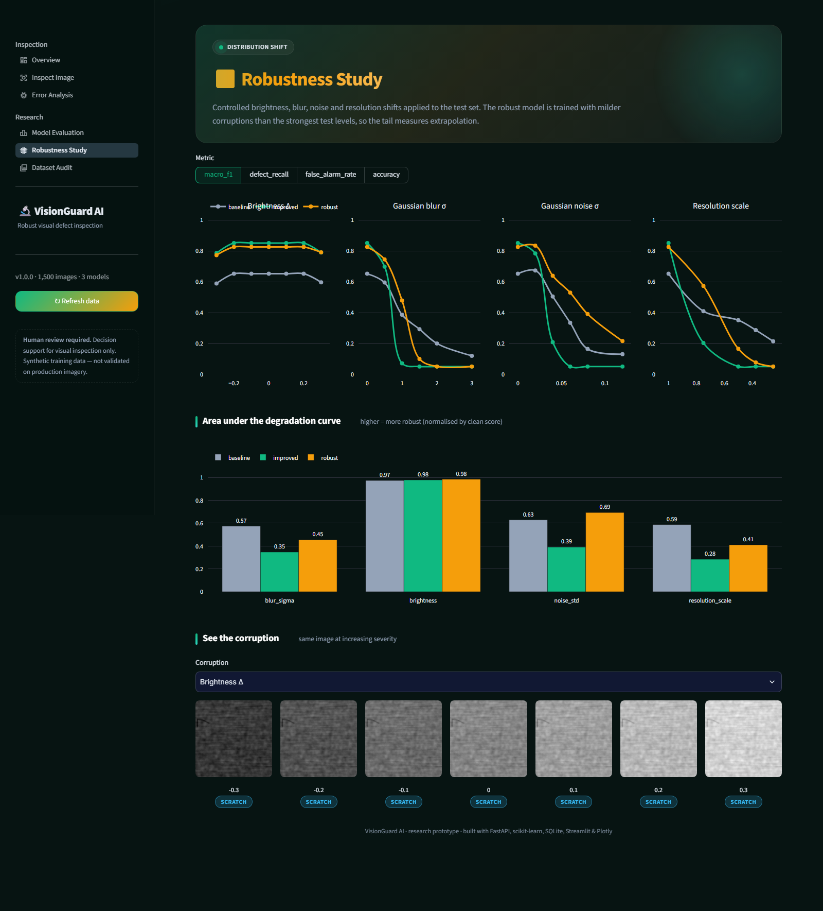
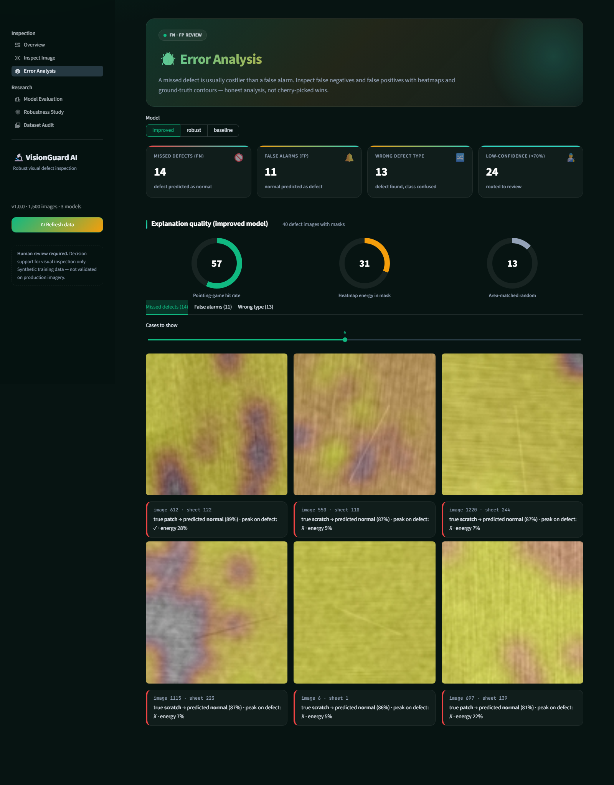
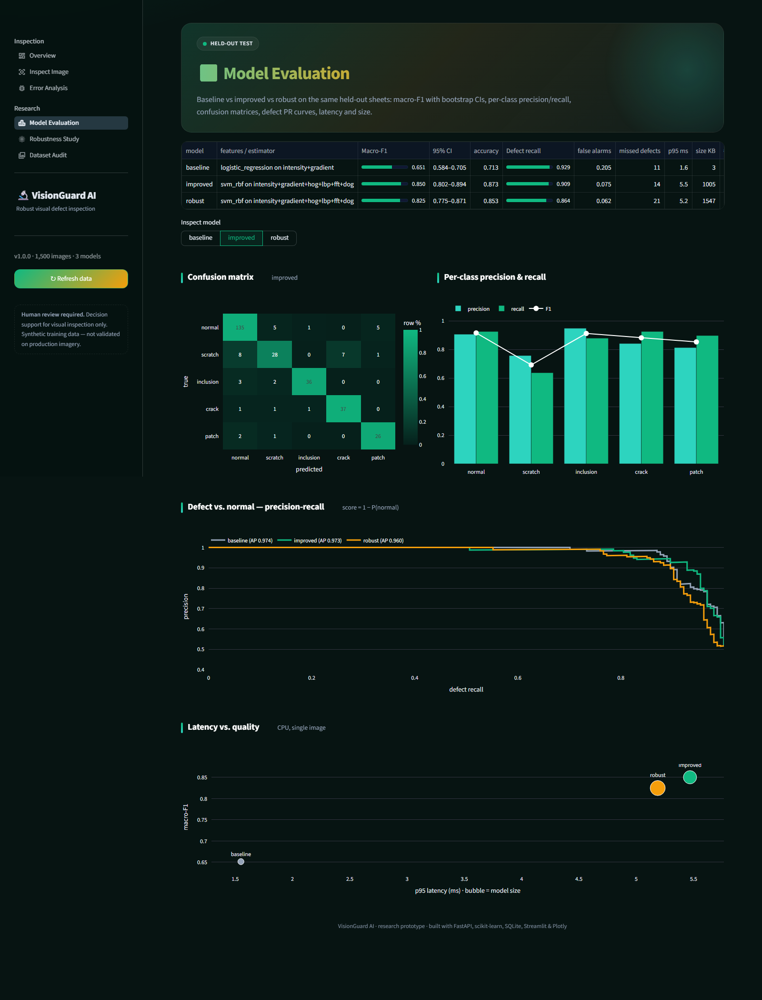
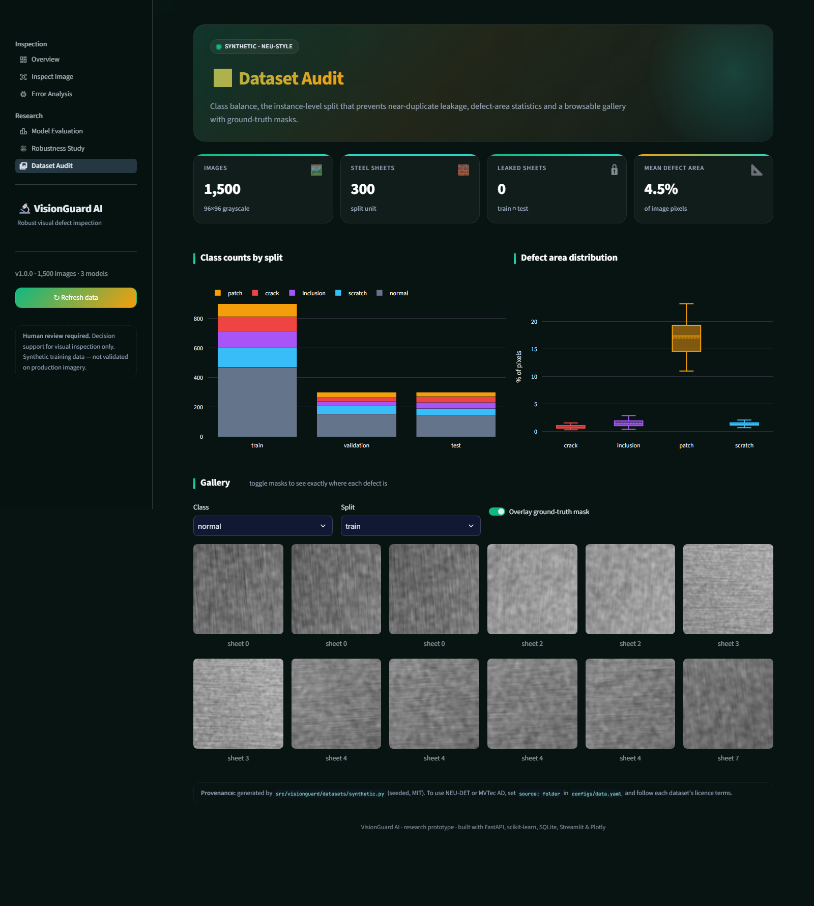
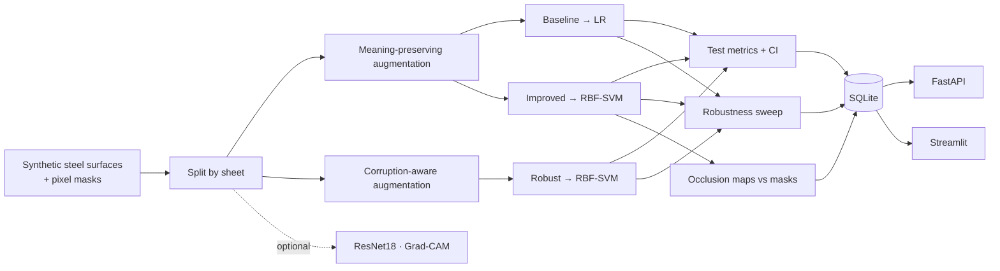

<p align="center">
  
</p>

<h1 align="center">VisionGuard AI</h1>
<p align="center"><b>Robust manufacturing defect detection & visual explainability</b><br/>
Classifies surface images as normal or one of four defect types, stress-tests robustness to lighting, blur, noise and
resolution shifts, and checks whether heatmaps actually land on the defect.</p>

<p align="center">
  <a href="https://github.com/Padu28/visionguard-ai/actions/workflows/ci.yml"></a>
  
  
  
  
  
  
</p>

<p align="center">
  <a href="#-highlights">Highlights</a> · <a href="#-results">Results</a> · <a href="#-screenshots">Screenshots</a> ·
  <a href="#-quick-start">Quick start</a> · <a href="#-api">API</a> · <a href="#-how-it-works">How it works</a> ·
  <a href="#%EF%B8%8F-limitations">Limitations</a>
</p>

> **Human review required.** VisionGuard prioritises images for inspection; it must not be the sole basis for
> accept/reject decisions. Trained on synthetic data.

---

## ✨ Highlights
- **Leakage-free split:** 1 500 images from 300 simulated steel sheets, split **by sheet** — 0 sheets shared between train and test.
- **Baseline → improved → robust:** intensity + gradient → LR vs HOG + LBP + FFT + DoG → RBF-SVM vs the same with corruption-aware augmentation.
- **Robustness study:** brightness, blur, noise and down-sampling sweeps with degradation curves for every model.
- **Explanations that are checked, not just shown:** occlusion heatmaps scored against true defect masks (pointing game, energy-in-mask).
- **Human-in-the-loop by design:** every defect or low-confidence prediction is flagged for review.
- **Optional deep learning:** ResNet18 transfer learning + Grad-CAM (`train-cnn`) — no CNN numbers are claimed until it has been run.
- **"Inspection Lab" dashboard:** light industrial UI with live inference, a corruption what-if slider, and error galleries.

## 📊 Results
*Held-out sheets (300 images). Macro-F1 with bootstrap 95 % CI.*

| Metric | Baseline<br/>intensity+gradient → LR | Improved<br/>HOG·LBP·FFT·DoG → RBF-SVM | Robust<br/>improved + corruption aug. |
|---|---|---|---|
| Macro-F1 | 0.651 (0.584–0.705) | **0.850** (0.802–0.894) | 0.825 (0.775–0.871) |
| Defect recall | 0.929 | 0.909 | 0.864 |
| False alarms on normal | 0.205 | 0.075 | **0.062** |
| Latency p95 (CPU) | 3.6 ms | 8.1 ms | 12.4 ms |

| Shift (macro-F1, improved → **robust**) | Mild | Moderate |
|---|---|---|
| Gaussian noise | σ 0.02: 0.78 → **0.83** | σ 0.04: 0.21 → **0.64** |
| Blur | σ 0.5: 0.70 → **0.74** | σ 1.0: 0.07 → **0.48** |
| Down-sampling | ×0.75: 0.20 → **0.57** | ×0.5: 0.05 → 0.17 |
| Brightness | ±0.2: unchanged | ±0.3: 0.78 → 0.77 |

**Explanation check:** the heatmap peak lands on the defect in **57 %** of defect images; **31 %** of heatmap energy is
inside the defect region vs ≈13 % for an area-matched random map.

<p align="center">
  
  
</p>

> **Honest reading.** Texture features are brittle — without corruption-aware training the model collapses at blur σ ≥ 1
> or noise σ ≥ 0.04. The robust variant trades ~2.5 points of clean macro-F1 for much better behaviour under moderate shift.
> The model always picks one of its 5 classes, even for images that are not steel surfaces (no out-of-distribution check yet).
> Full report: [`reports/evaluation_report.md`](reports/evaluation_report.md).

## 📸 Screenshots
<table>
  <tr>
    <td width="50%"><br/><sub><b>Overview</b> — laser-scan hero, KPIs, per-class recall, sample inspections</sub></td>
    <td width="50%"><br/><sub><b>Inspect Image</b> — prediction, heatmap, corruption what-if, review flag</sub></td>
  </tr>
  <tr>
    <td><br/><sub><b>Robustness Study</b> — degradation curves and severity strip</sub></td>
    <td><br/><sub><b>Error Analysis</b> — missed defects and false alarms with heatmaps</sub></td>
  </tr>
  <tr>
    <td><br/><sub><b>Model Evaluation</b> — confusion matrices, per-class P/R, latency vs quality</sub></td>
    <td><br/><sub><b>Dataset Audit</b> — class balance, defect areas, mask gallery</sub></td>
  </tr>
</table>

## 🚀 Quick start
**Requirements:** Python 3.11 or 3.12 · no GPU (PyTorch optional).

<details open>
<summary><b>Windows (PowerShell)</b></summary>

```powershell
git clone https://github.com/Padu28/visionguard-ai.git
cd visionguard-ai
py -3.12 -m venv .venv
.\.venv\Scripts\Activate.ps1
pip install -r requirements-dev.txt
pip install -e .
python -m visionguard.cli pipeline                     # ≈4 min: images, 3 models, robustness, explanations
streamlit run dashboard/app.py --server.port 8503      # → http://localhost:8503
```
</details>

<details>
<summary><b>macOS / Linux</b></summary>

```bash
git clone https://github.com/Padu28/visionguard-ai.git && cd visionguard-ai
python3.12 -m venv .venv && source .venv/bin/activate
pip install -r requirements-dev.txt && pip install -e .
python -m visionguard.cli pipeline
streamlit run dashboard/app.py --server.port 8503
```
</details>

<details>
<summary><b>Docker</b> · <b>Optional CNN</b></summary>

```bash
docker build -f docker/Dockerfile -t visionguard-ai .
docker run -p 8002:8002 -p 8503:8503 visionguard-ai

pip install -r requirements-cnn.txt && python -m visionguard.cli train-cnn   # ResNet18 + Grad-CAM
```
</details>

**API:** `uvicorn api.main:app --reload --port 8002` → http://localhost:8002/docs

## 🔌 API
| Method | Endpoint | Purpose |
|---|---|---|
| `GET` | `/health` | Status and available models |
| `POST` | `/predict?model=improved&explain=true` | Upload PNG/JPG → label, probabilities, review flag, heatmap (base64 PNG) |
| `GET` | `/metrics` | Test metrics, explanation check, dataset audit |
| `GET` | `/robustness` | Robustness sweep results |
| `GET` | `/inference-log` | Recent inferences |

```bash
curl -X POST "localhost:8002/predict?model=improved" -F "file=@data/sample/img_00031_inclusion.png"
```
```json
{ "label": "inclusion", "confidence": 0.882, "defect_score": 0.9997, "needs_human_review": true,
  "probabilities": {"normal": 0.0003, "scratch": 0.0971, "inclusion": 0.882, "crack": 0.0205, "patch": 0.0001},
  "model_version": "vg-1.0.0-improved" }
```
Of the 20 sample images in `data/sample/`, the improved model labels 16 correctly. The misses are visible on purpose:
`img_00006_scratch.png` is called *normal* (a missed defect), and two cracks and one inclusion are called *scratch*.

## 🏗 How it works

Dataset details: [`docs/DATA_CARD.md`](docs/DATA_CARD.md)

## 📁 Project structure
```
visionguard-ai/
├── configs/              data.yaml · augmentation.yaml · training.yaml
├── src/visionguard/
│   ├── datasets/         synthetic generator with masks · instance split · audit
│   ├── transforms/       augmentation · corruption-aware augmentation · test corruptions
│   ├── models/           handcrafted features · feature classifiers · PyTorch CNNs (optional)
│   ├── training/         experiment pipeline · CNN transfer-learning loop
│   ├── inference/        predictor with human-review flag
│   ├── evaluation/       macro-F1, per-class, defect PR, bootstrap CI, figures
│   ├── explainability/   occlusion maps · Grad-CAM · pointing game · energy-in-mask
│   └── storage/          SQLite results & inference log
├── api/ · dashboard/ ("Inspection Lab" design) · notebooks/ · tests/ (15) · reports/ · scripts/ · docs/ · docker/
```

## ✅ Testing
`pytest -q` — 15 tests: dataset determinism, mask/label consistency, leakage-free split, augmentation invariants,
illumination invariance of features, model quality, explanation verification, API.

## ⚠️ Limitations
- Synthetic data — validate on NEU-DET or MVTec AD before any claim.
- No out-of-distribution rejection: non-steel images still get one of the 5 labels.
- CNN code is included but no CNN results are reported until it has been run.
- Heatmaps are diagnostic aids, not proof of the model's reasoning.

## 🗺 Roadmap
- [ ] Out-of-distribution "not a steel surface" detector
- [ ] ResNet18 results with stronger augmentation
- [ ] NEU-DET / MVTec AD adapters and benchmarks

## 🔗 Related projects
| Project | Focus |
|---|---|
| 🛰️ [SentinelML](https://github.com/Padu28/sentinelml) | Drift monitoring & adaptive retraining |
| 🛡️ [ThreatSense](https://github.com/Padu28/threatsense) | Explainable network anomaly detection |
| 🩺 [MedPredict Research](https://github.com/Padu28/medpredict-research) | Calibrated, fair clinical risk models |

## 👤 Author
**Padmashree Shah** · [GitHub](https://github.com/Padu28)

<sub>MIT licensed · research prototype · not affiliated with or endorsed by Microsoft.</sub>
